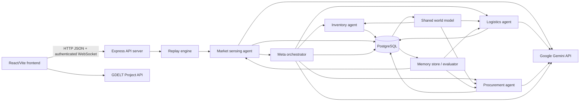

# Verdant

Verdant is a Node.js/PostgreSQL supply-chain decision system for operations teams that need to assess replayed disruptions across ports, routes, suppliers, and SKUs. It validates disruption events, asks specialist agents for assessments or proposed mitigations, records decisions, and exposes the results through an authenticated API and WebSocket stream. The repository also contains a React/Vite dashboard implementation, although those frontend files are currently marked deleted in the working tree and must be restored before the frontend can run.

The active backend does not consume a live supply-chain feed. Its included scenario is an accelerated Panama Canal disruption replay from `data/panama_replay.js`; Gemini is used for selected assessments and proposals, and PostgreSQL stores the world model, decision log, HITL cards, lessons, and agent versions.

## Demo

- Screenshots: TODO
- Demo link: TODO

## How it works

1. `world/worldModel.js` loads approved suppliers, ports, routes, and SKUs from PostgreSQL when `server.js` starts.
2. An authenticated client starts the replay through `POST /api/replay/start`. `world/replayEngine.js` emits the seven events in `data/panama_replay.js` on an accelerated clock.
3. `agents/marketSensingAgent.js` validates each event, retrieves similar lessons, and asks Gemini for a risk assessment. If Gemini fails or returns invalid JSON, it uses a deterministic severity/penalty fallback.
4. `agents/metaOrchestrator.js` runs inventory and logistics in parallel, runs procurement when any SKU is high risk, then asks Gemini to arbitrate the proposals.
5. Inventory calculations are deterministic. Logistics and procurement classify proposals as `autonomous` or `hitl_required` using the champion budget and alert thresholds. HITL decisions are stored in `hitl_cards`.
6. All agent decisions are written to `decision_log` and broadcast over the authenticated WebSocket connection. When a replay stops, `memory/lessonWriter.js` writes phase summaries to `agent_memory`; every third phase invokes the champion/challenger evaluator.



**Implementation references:** `server.js`, `world/replayEngine.js`, `data/panama_replay.js`, `agents/*.js`, `db/schema.sql`, `lib/gemini.js`, `memory/*.js`, and `frontend/src/data/*.js`.

## Agents

| Agent | File | What it does | Inputs | Outputs | LLM calls |
|---|---|---|---|---|---|
| Market sensing | `agents/marketSensingAgent.js` | Validates and assesses a replayed disruption using related lessons. | Raw `Event`, replay phase, retrieved memory | `{ event, assessment }` with `risk_factor`, `lead_time_penalty_days`, affected routes, and reasoning | One Gemini call through `lib/gemini.js`; deterministic fallback on failure |
| Inventory | `agents/inventoryAgent.js` | Calculates hours to stockout and risk for every loaded SKU, adjusted by the event penalty and risk factor. | Market assessment, replay phase, `worldModel.skus` | Forecasts and a `highRisk` list | None; calculations are deterministic |
| Logistics | `agents/logisticsAgent.js` | Proposes a reroute or supplier switch for a port disruption and decides whether human approval is required. | Event, assessment, champion thresholds, replay phase, ports, retrieved lessons | Validated `plan` and `autonomyLevel`; may create a HITL card | One Gemini call; validated with `GeminiPlan`, deterministic fallback |
| Procurement | `agents/procurementAgent.js` | Proposes one procurement action when at least one SKU has stockout risk above `0.5`. | Inventory forecasts, assessment, champion thresholds, suppliers, retrieved lessons | Validated `plan` and `autonomyLevel`; may create a HITL card | One Gemini call; validated with `GeminiPlan`, deterministic fallback |
| Meta-orchestrator | `agents/metaOrchestrator.js` | Coordinates inventory/logistics/procurement and arbitrates their proposals. | Market result, raw event, replay phase, champion version | Gemini arbitration with final decision, total cost, lead-time impact, and confidence | One Gemini call; deterministic summary fallback |

The typed messages used by the agents are declared in `lib/schemas.js`: `Event`, `Forecast`, `Plan`, `Action`, and `GeminiPlan`.

## Tech stack

Versions below are the version specifiers declared in the package manifests, not necessarily the versions installed on a particular machine.

### Root backend (`package.json`)

| Package | Declared version |
|---|---:|
| Node.js runtime | Not declared in `package.json` |
| `express` | `^5.3.0` |
| `pg` | `^8.23.1` |
| `bcrypt` | `^6.0.0` |
| `jsonwebtoken` | `^9.0.3` |
| `cookie-parser` | `^1.4.7` |
| `dotenv` | `^18.0.7` |
| `express-rate-limit` | `^8.7.1` |
| `helmet` | `^8.3.0` |
| `ws` | `^8.22.0` |
| `zod` | `^4.6.5` |
| `uuid` | `^14.0.3` |

The root manifest declares dependencies but no `scripts`; run the backend with `node server.js`.

### Frontend (`frontend/package.json`, tracked in `HEAD`)

| Package | Declared version |
|---|---:|
| `react` | `latest` |
| `react-dom` | `latest` |
| `vite` | `latest` |
| `@vitejs/plugin-react` | `latest` |
| `leaflet` | `^1.9.4` |
| `react-leaflet` | `^5.0.0` |
| `react-icons` | `^5.5.0` |
| `tailwindcss` | `^4.3.3` |
| `@tailwindcss/postcss` | `^4.3.3` |
| `postcss` | `^8.5.3` |
| `autoprefixer` | `^10.4.21` |

Frontend scripts are `npm run dev`, `npm run build`, and `npm run preview`.

### Separate `security/` package

`security/package.json` is a second Express application named `kalaseo` (`1.0.0`) with `express ^5.2.1`, `pg ^8.23.1`, `bcrypt ^6.0.0`, `jsonwebtoken ^9.0.3`, `helmet ^8.3.0`, `cookie-parser ^1.4.7`, `dotenv ^18.0.6`, and `express-rate-limit ^8.7.1`. It is not imported by the root `server.js`.

## Features

- PostgreSQL world model for approved suppliers, ports, routes, and SKUs (`world/worldModel.js`, `db/schema.sql`).
- Accelerated seven-event Panama Canal replay (`data/panama_replay.js`, `world/replayEngine.js`).
- Market-sensing, inventory, logistics, procurement, and meta-orchestration agents (`agents/`).
- Gemini-backed structured assessments and proposals with JSON parsing and deterministic fallbacks (`lib/gemini.js`, `agents/*.js`).
- Zod validation for replay events and Gemini plans (`lib/schemas.js`).
- Decision audit log, replay phases, estimated costs, autonomy levels, and predicted outcomes (`db/schema.sql`, `routes/decisions.js`).
- Human-in-the-loop cards for logistics and procurement proposals that exceed the champion thresholds (`routes/hitl.js`).
- Full-text lesson retrieval, post-replay lesson writing, and champion/challenger version evaluation (`memory/`, `agent_memory` and `agent_versions` tables).
- JWT authentication using an HTTP-only cookie or bearer token, administrator-only HITL approval/rejection, and session invalidation on logout (`routes/auth.js`, `middleware/auth.js`).
- Authenticated WebSocket events for replay, assessments, forecasts, agent decisions, HITL cards, lessons, and champion updates (`server.js`, `lib/broadcast.js`).
- React/Vite dashboard pages in the tracked frontend: command center, agent network, global map, market signals, decision logs, settings, login, and signup (`frontend/src/`).
- Frontend command-center and global-map data can use the backend status/decision/HITL APIs; local mock data is used when those calls fail (`frontend/src/data/mockApi.js`).
- Market Signals fetches recent supply-chain-related headlines from the GDELT Project API and ranks them using headline metadata (`frontend/src/MarketSignals.jsx`).

## Planned / Not yet implemented

- Live supply-chain event ingestion is not implemented. The backend only runs the static replay in `data/panama_replay.js`.
- Agent plans are logged and surfaced; the code does not execute purchase orders, reroute shipments, or update inventory as a real operational system.
- `decision_log.actual_outcome` is defined in the schema but no active code records actual outcomes. Memory scores are based on estimated cost in `memory/lessonWriter.js`.
- The champion/challenger evaluator mutates thresholds and estimates a challenger score from logged decisions; it is not a production experiment framework and has no rollback API.
- The frontend is absent from the current working tree even though its files are tracked in `HEAD` and referenced by the existing project layout. Restore the deleted `frontend/` files before installing or building it.
- No frontend environment example is provided. The tracked frontend defaults `VITE_API_URL` to `http://localhost:3001`.
- The root application and the `security/` application are not integrated. The security application expects a different `users` shape and references files/directories not present under `security/`.
- There is no declared production deployment configuration, migration tool, background worker, or automated CI test workflow.

## Project structure

```text
.
├── agents/                 # Market sensing, inventory, logistics, procurement, and orchestration logic
│   ├── marketSensingAgent.js
│   ├── inventoryAgent.js
│   ├── logisticsAgent.js
│   ├── procurementAgent.js
│   └── metaOrchestrator.js
├── data/                   # Static replay event data
│   └── panama_replay.js
├── db/                     # PostgreSQL pool, schema, and user seeding
│   ├── client.js
│   ├── schema.sql
│   └── seed_users.js
├── frontend/               # Tracked React/Vite dashboard; currently deleted in the working tree
│   ├── src/App.jsx         # Authenticated shell and page routing
│   ├── src/AuthPage.jsx    # Login/signup UI
│   ├── src/GlobalMap.jsx   # Leaflet map view
│   ├── src/MarketSignals.jsx # GDELT headline screening
│   ├── src/DecisionLogs.jsx
│   ├── src/SettingsPage.jsx
│   └── src/data/           # API, auth, and mock data adapters
├── lib/                    # Gemini client, Zod schemas, and WebSocket broadcast helper
├── memory/                 # Lesson storage, lesson writer, and evaluator
├── middleware/             # Root API JWT authentication and role checks
├── routes/                 # Root API route modules
├── security/               # Separate, unintegrated authentication/scan prototype
├── world/                  # Shared world model and replay engine
├── .env.example            # Root backend environment template
├── server.js               # Root Express and WebSocket entrypoint
├── test_all.js             # End-to-end smoke runner for replay and API flows
├── test_connection.js      # Backend connection smoke runner
├── package.json            # Root dependency manifest; no npm scripts
├── package-lock.json       # Root lockfile
└── README.md               # This documentation
```

## Setup

### Prerequisites

- Node.js and npm. The repository does not pin a Node.js version.
- PostgreSQL 18-compatible database; the schema comment identifies PostgreSQL 18 compatibility.
- A Gemini API key for non-fallback agent assessments and proposals.
- The frontend files must exist if the dashboard is needed. In this worktree they are marked deleted; restore them from the repository version before running frontend commands.

### Install dependencies

From the repository root:

```powershell
npm install
```

If the frontend files have been restored:

```powershell
Set-Location frontend
npm install
Set-Location ..
```

The separate `security/` package has its own dependencies and is not required by the root application:

```powershell
Set-Location security
npm install
Set-Location ..
```

### Environment variables

Copy `.env.example` to `.env` and replace placeholders:

| Variable | Used for |
|---|---|
| `GEMINI_API_KEY` | API key sent to Google Gemini by `lib/gemini.js` and the separate `security/server.js` scan route. |
| `PG_HOST` | PostgreSQL hostname for `db/client.js`. |
| `PG_PORT` | PostgreSQL port for `db/client.js`. |
| `PG_DATABASE` | Database name for `db/client.js`. |
| `PG_USER` | PostgreSQL user for `db/client.js`. |
| `PG_PASSWORD` | PostgreSQL password for `db/client.js`. |
| `PORT` | Root server port; defaults to `3001` in `server.js`. |
| `JWT_SECRET` | Secret used to sign and verify root API JWTs. |

The code also reads optional variables that are not included in `.env.example`: `FRONTEND_ORIGINS` controls allowed browser origins, `NODE_ENV` controls development origin behavior and cookie security, and `JWT_EXPIRES_IN` controls the root auth token lifetime with an `8h` default in `routes/auth.js`. The tracked frontend reads `VITE_API_URL`, defaulting to `http://localhost:3001`.

### Create and seed PostgreSQL

The schema is self-seeding for the demo users, champion version, ports, suppliers, and SKUs. From a PostgreSQL client machine:

```powershell
createdb -U postgres supply_chain
psql -U postgres -d supply_chain -f db/schema.sql
```

The schema inserts:

- `demo@verdant.ai` and `admin@verdant.ai`, both administrators, with the documented demo password `password123`.
- A champion agent version `v1`.
- Four ports, three suppliers, and three SKUs when those tables are empty.

`db/seed_users.js` is an optional password refresh/seed script. Run it after `.env` is configured:

```powershell
node db/seed_users.js
```

It also uses `password123` for both demo users and updates their password hashes and administrator roles.

### Run the backend

```powershell
node server.js
```

The backend listens on `http://localhost:3001` by default and exposes `GET /health`. It loads the world model before accepting requests. Use the root process, not `security/server.js`, for the supply-chain API.

### Run the frontend

After restoring the tracked `frontend/` files:

```powershell
Set-Location frontend
npm run dev
```

The Vite development server normally runs on its own default port and uses `VITE_API_URL` to locate the backend. The frontend also has `npm run build` and `npm run preview`.

### Run tests and smoke checks

The root manifest has no test script. With the backend running and the database seeded:

```powershell
node test_connection.js
node test_all.js
```

`test_connection.js` checks health, demo login, `/api/auth/me`, status, decisions, pending HITL cards, signup, and authenticated WebSocket access. `test_all.js` starts the replay, listens for WebSocket events, checks HITL and memory endpoints, and inspects version history. These are executable smoke scripts rather than a unit-test suite.

## API reference

All routes below are mounted by the root `server.js`. Except where noted, protected routes require a valid JWT supplied as an `Authorization: Bearer ...` header, the `token` cookie, or a query token accepted by `middleware/auth.js`.

| Method | Path | Auth required | Purpose |
|---|---|---:|---|
| GET | `/health` | No | Returns `{ ok: true, time }`. |
| POST | `/api/auth/signup` | No | Creates an administrator account and issues a session. |
| POST | `/api/auth/login` | No | Validates email/password and issues a JWT session. Login is rate limited. |
| POST | `/api/auth/logout` | No* | Invalidates the current user's tokens when a valid cookie is supplied and clears the cookie. |
| GET | `/api/auth/me` | Yes | Returns the authenticated user's profile. |
| GET | `/api/status` | Yes | Returns the loaded suppliers, ports, routes, and SKUs snapshot. |
| GET | `/api/decisions` | Yes | Returns paginated decision-log rows; supports `page` and `limit` query parameters. |
| POST | `/api/replay/start` | Yes | Starts the accelerated replay, or returns an already-running error. |
| POST | `/api/replay/stop` | Yes | Stops the replay and triggers lesson writing. |
| GET | `/api/hitl/pending` | Yes | Lists pending HITL cards with related decision information. |
| POST | `/api/hitl/:id/approve` | Yes, administrator | Approves a pending HITL card and marks its decision `hitl_approved`. |
| POST | `/api/hitl/:id/reject` | Yes, administrator | Rejects a pending HITL card and marks its decision `hitl_rejected`. |
| GET | `/api/memory` | Yes | Returns all stored lessons, newest first. |
| GET | `/api/memory/chart` | Yes | Returns average outcome score and decision count by replay phase. |
| GET | `/api/memory/versions` | Yes | Returns agent version history ordered by creation time. |

`*` Logout is callable without authentication because it clears the cookie; token invalidation occurs only when the cookie verifies successfully. The WebSocket endpoint uses the same server port (`ws://localhost:3001` by default), requires a valid token during upgrade, and accepts `ping` messages that receive `pong`.

## Security

- Root routes use JWTs signed with `JWT_SECRET` (`routes/auth.js`, `middleware/auth.js`).
- Sessions are stored in an HTTP-only cookie and also returned as a token to the frontend. Production mode sets the cookie `secure` flag; the root auth route uses `sameSite: 'lax'`.
- Logout updates `users.token_invalid_before`; the middleware rejects tokens issued at or before that timestamp.
- Passwords are hashed with bcrypt cost 12 during signup and demo seeding.
- Login input is validated with Zod; duplicate email signup returns `409`.
- Administrator-only middleware protects HITL approval and rejection.
- Helmet security headers, JSON body-size limits, origin allowlisting, CORS credentials, and an `/api` rate limiter are configured in `server.js`.
- The root API rate limiter allows 600 requests per 15 minutes per limiter key. Login has an additional limit of 100 attempts per 15 minutes in `routes/auth.js`.
- WebSocket upgrades validate origin and JWT/session revocation before completing the upgrade.
- SQL uses parameterized queries throughout the root route and agent code.

Known security boundaries: the middleware accepts a JWT in a query parameter for WebSocket compatibility; the root `.env.example` uses placeholders but does not enforce secret strength; and no CSRF token mechanism, account recovery flow, or refresh-token rotation is implemented. The `security/` directory is a separate prototype, not an additional protection layer for the root server.

## Limitations and known issues

- The current working tree has the tracked frontend files deleted, so `frontend/` is empty locally until those changes are restored.
- The root backend has no npm `start`, `dev`, or `test` script.
- `test_all.js` and `test_connection.js` contain redacted-looking `Authorization` template fragments in the checked-out source and should be reviewed before relying on them as automated checks.
- The replay timer is process-local and cannot be coordinated across multiple backend instances.
- Agent proposals use estimated costs and lead times; there is no carrier, supplier, purchase-order, or shipment execution integration.
- The replay data is illustrative and explicitly marked as replayed; it is not a live Panama Canal or logistics feed.
- Gemini output is parsed from text and falls back on errors, but the orchestrator's fallback is a summary rather than a fully validated arbitration schema.
- Pagination parameters in `routes/decisions.js` are parsed but not range-validated.
- The frontend's fallback mock dataset can display synthetic values when the backend is unavailable. The dashboard is therefore not a source of operational truth.
- The separate `security/` application has a different authentication schema (`username`/`password`), a different database configuration (`DATABASE_URL`), and references missing `security/middleware/auth.js` and `security/public/` paths.

## Team and my role

TODO: Add team members, affiliations, and my role.

## License

TODO: Add the project license and any third-party attribution requirements.

## Root-file clutter candidates

These root files look like notes or planning material rather than runtime source:

| File | Suggested location |
|---|---|
| `.txt` | Rename with a descriptive name and move to `docs/notes/`, or remove after confirming it is no longer needed. |
| `PS1_logic.txt` | `docs/` or `docs/design/`; it contains design guidance rather than executable code. |
| `PS1 - Self-Evolving AI Agent Networks for Global Supply Chains.pdf` | `docs/reference/` |
| `PS2 - Autonomous Enterprise AI Architecture Plan.pdf` | `docs/reference/` |

Do not move `.env`; it contains local configuration and is ignored by Git. `security/` is not a stray duplicate script but a separate, currently unintegrated prototype and should be moved or removed only after confirming that it is no longer part of the project scope.
